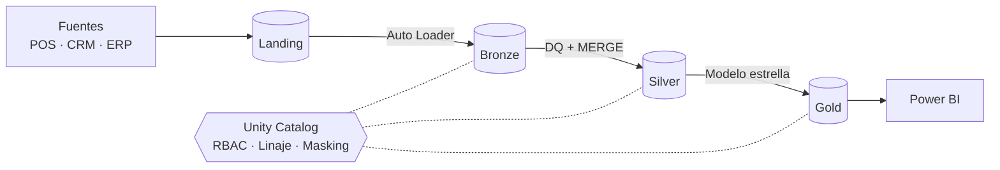

# End-to-End Enterprise Data Lakehouse & Governance

`PySpark` · `Databricks` · `Delta Lake` · `Unity Catalog` · `Power BI`

## Problema

Los datos transaccionales viven fragmentados en sistemas aislados (POS, CRM, ERP), sin control de accesos ni calidad centralizada: cada área reconstruye sus cifras y nadie puede responder quién ve qué ni de dónde viene un número.

## Solución

- **Arquitectura Medallion** (Bronze → Silver → Gold) sobre Delta Lake, diseñada para procesar **1 M+ de registros diarios** de forma incremental.
- **Gobernanza con Unity Catalog**: RBAC por grupos con mínimo privilegio, máscaras de columna para PII, filtros de fila por región, etiquetas de clasificación y linaje de tabla/columna.
- **Calidad de datos** declarativa con cuarentena de registros inválidos, métricas por regla y una compuerta (`dq_gate`) que detiene el workflow.
- **Optimización de consultas** (Liquid Clustering, OPTIMIZE, broadcast joins, mart pre-agregado) con un benchmark reproducible que *mide* la mejora.
- **Tablero ejecutivo en Power BI** sobre la capa Gold vía SQL Warehouse.



Diagramas completos (orquestación, secuencia, modelo ER, RBAC, linaje) en [docs/architecture.md](docs/architecture.md).

## Estructura

| Ruta | Contenido |
|---|---|
| [src/lakehouse/ingestion](src/lakehouse/ingestion/generate_data.py) | Generador sintético con defectos de calidad inyectados |
| [src/lakehouse/bronze](src/lakehouse/bronze/ingest_transactions.py) | Ingesta con Auto Loader |
| [src/lakehouse/silver](src/lakehouse/silver) | Limpieza, dedupe, DQ, MERGE incremental, SCD2 |
| [src/lakehouse/gold](src/lakehouse/gold/build_marts.py) | Hechos, dimensiones y mart agregado |
| [src/lakehouse/governance](src/lakehouse/governance) | SQL de Unity Catalog (grants, tags, masks, filtros) y `dq_gate` |
| [src/lakehouse/optimization](src/lakehouse/optimization/benchmark.py) | Benchmark baseline vs optimizado |
| [databricks.yml](databricks.yml) | Workflow como código (Databricks Asset Bundle) |
| [powerbi/](powerbi/measures.dax) · [docs/powerbi.md](docs/powerbi.md) | Medidas DAX, modelo y diseño del tablero |
| [tests/](tests) | Pruebas unitarias con PySpark local |

## Cómo ejecutarlo

**Local (pruebas y muestra)** — requiere Python ≥ 3.10 y Java 17:

```bash
make install
make test
make sample        # genera 20 000 transacciones en data/landing
```

**En Databricks**

1. Ejecutar `src/lakehouse/governance/setup_unity_catalog.sql` (reemplazar `${env}`), luego `row_column_security.sql` tras el primer Gold.
2. Generar datos en el volumen de landing: `python -m lakehouse.ingestion.generate_data --out /Volumes/lakehouse_dev/landing/raw --rows 1000000 --date <YYYY-MM-DD> --with-dims`.
3. `make deploy` (construye el wheel y despliega el bundle) y ejecutar el job `medallion-pipeline-dev`.
4. Ejecutar `benchmark` y registrar los resultados en [docs/optimization.md](docs/optimization.md).
5. Conectar Power BI según [docs/powerbi.md](docs/powerbi.md).