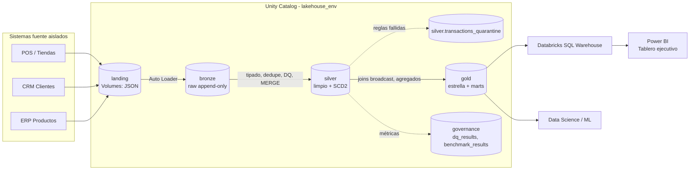
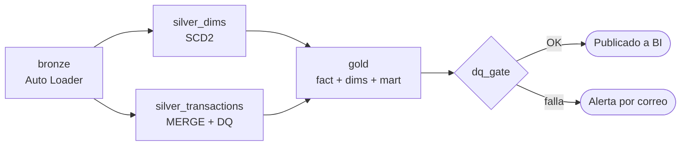
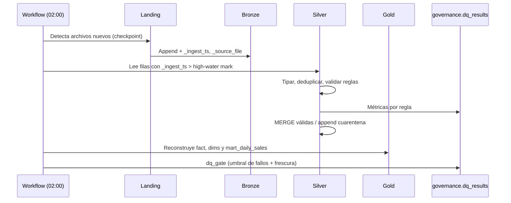
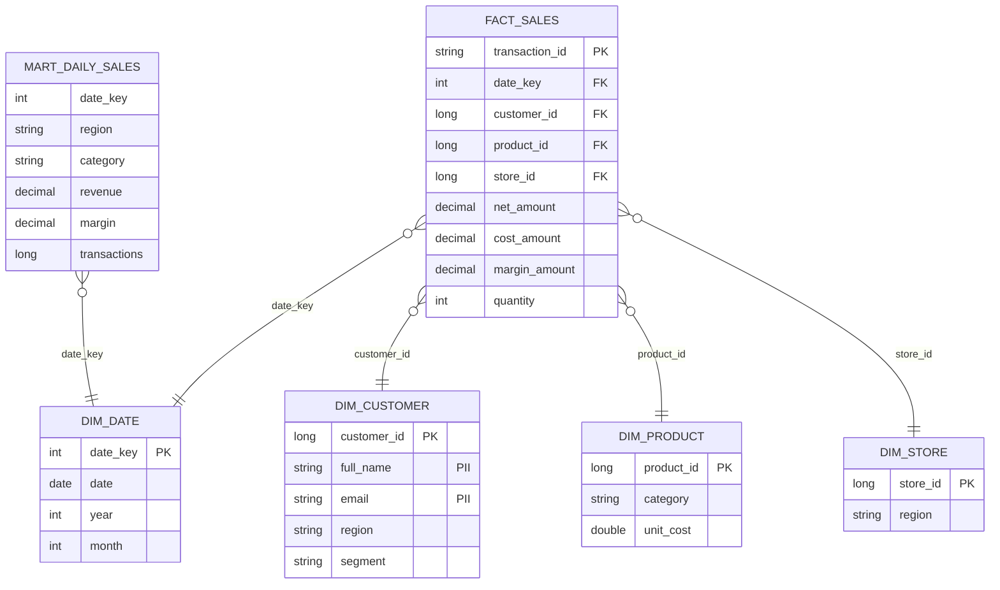

# Arquitectura

## 1. Visión end-to-end (Medallion)

## 2. Orquestación (Databricks Workflow)

## 3. Secuencia de una corrida incremental

## 4. Modelo dimensional (Gold)

## 5. Decisiones de diseño

| Decisión | Motivo |
|---|---|
| Auto Loader con `availableNow` | Ingesta incremental con checkpoint, sin clúster 24/7 |
| Bronze sin transformar | Reprocesable y auditable; la fuente de verdad cruda |
| `MERGE` por `transaction_id` con condición `_ingest_ts` | Idempotencia: reejecutar no duplica ni retrocede datos |
| Cuarentena en vez de descartar | Los datos defectuosos se investigan y se pueden reinyectar |
| SCD2 solo en clientes | Es la dimensión cuyo histórico (región/segmento) afecta el análisis |
| Liquid Clustering `(event_date, store_id)` | Reemplaza particionado + ZORDER; evita small files y es adaptable |
| Mart pre-agregado | El tablero consulta miles de filas, no millones |
