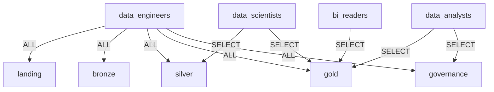
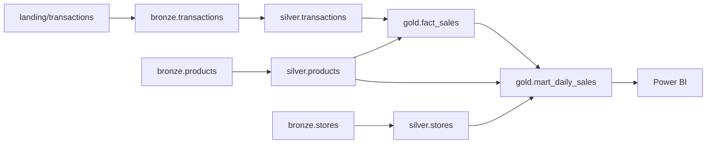

# Gobernanza con Unity Catalog

Scripts: [setup_unity_catalog.sql](../src/lakehouse/governance/setup_unity_catalog.sql) y [row_column_security.sql](../src/lakehouse/governance/row_column_security.sql).

## Jerarquía

`metastore → lakehouse_{env} (catálogo) → landing | bronze | silver | gold | governance → tablas / volúmenes`

Un catálogo por entorno (`lakehouse_dev`, `lakehouse_prod`) aísla permisos y datos entre entornos.

## Matriz RBAC (mínimo privilegio)

| Grupo | landing | bronze | silver | gold | governance |
|---|---|---|---|---|---|
| `data_engineers` | ALL | ALL | ALL | ALL | ALL |
| `data_scientists` | – | – | SELECT | SELECT | – |
| `data_analysts` | – | – | – | SELECT | SELECT |
| `bi_readers` | – | – | – | SELECT | – |

Bronze no se expone a consumidores. Los permisos se asignan a **grupos**, nunca a usuarios individuales.

## Seguridad a nivel de fila y columna

- **Column mask** sobre `email` y `full_name` de `gold.dim_customer`: solo `pii_readers` ve el valor real; el resto ve `*****@dominio` / `*** MASKED ***`.
- **Row filter** sobre `dim_store` y `mart_daily_sales`: cada gerente regional (`region_NORTE`, …) ve únicamente su región; `data_engineers` y `all_regions` ven todo.

Se aplica en la tabla, por lo que protege cualquier consumidor (SQL, notebooks, Power BI).

## Clasificación y descubrimiento

Columnas PII etiquetadas con `classification = pii`; esquemas con `layer = bronze|silver|gold`. Permite buscar y auditar datos sensibles desde Catalog Explorer.

## Linaje y auditoría

Unity Catalog captura linaje automáticamente (tabla y columna) para cualquier consulta ejecutada en Databricks. Consultas de ejemplo en el SQL de setup:

- `system.access.table_lineage` / `column_lineage`: de qué tablas y columnas proviene `gold.fact_sales`.
- `system.access.audit`: quién accedió a tablas PII.

> El diagrama representa el linaje esperado; el linaje real se consulta y se visualiza en Catalog Explorer una vez ejecutado el pipeline en un workspace con Unity Catalog.

## Calidad de datos

Reglas declarativas en [transformations.py](../src/lakehouse/silver/transformations.py): ids no nulos, cantidad > 0, precio ≥ 0, descuento en [0,1], estado válido. Las filas que fallan van a `silver.transactions_quarantine` con la lista de reglas incumplidas, y las métricas a `governance.dq_results`. La tarea `dq_gate` hace fallar el workflow si la tasa de fallos supera el 5 % o los datos están desactualizados (> 26 h).

> Para datos sintéticos de una fecha fija, el chequeo de frescura fallará con el tiempo; regenere datos con la fecha actual o ajuste `MAX_STALENESS_HOURS`.
